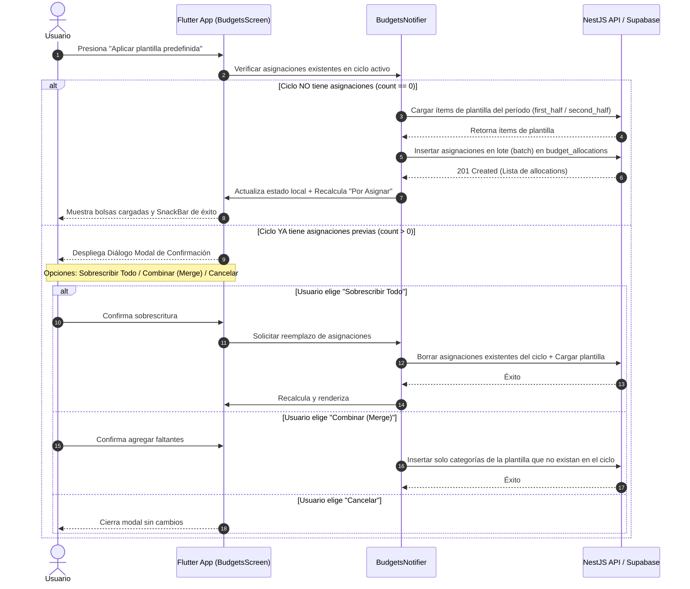
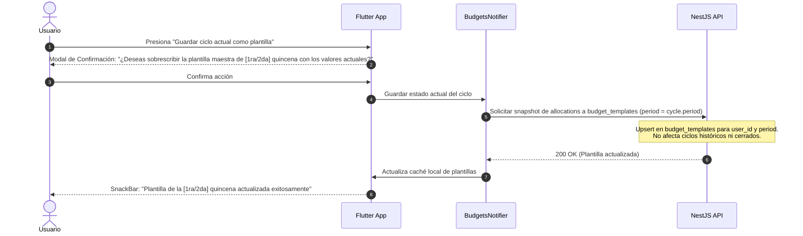

# Informe de Minería y Especificación Técnica: RF-03 y RF-04

**Proyecto:** Quincena Mobile App & API  
**Módulo:** Distribución Quincenal, Presupuestos Base Cero y Plantillas Maestras (RF-03 & RF-04)  
**Fecha:** Octubre 2026  
**Investigador / Rol:** Specification Miner & Requirements Investigator  
**Estado:** Especificación Técnica Completa y Validada  

---

## 1. Fuentes Autoritativas de Especificación

El presente informe consolida la evidencia extraída directamente de las siguientes fuentes autoritativas del proyecto:

1. **Documentos DERCAS (OneDrive / Local):**
   - `dercas_quincena.md` (v1.0): Filosofía *Zero-Based Budgeting* quincenal, ciclo de vida de ingresos y consumos.
   - `dercas_1_1_quincena.md` (v1.1): Adición de plantillas predefinidas para 1ra (1–15) y 2da quincena (16–fin de mes).
   - `dercas_1_2.md` (v1.2): Integración de cuentas financieras de destino (`financial_accounts`), enlace con `budget_allocations` y `budget_templates`.
   - `dercas_1_3.md` (v1.3): Consolidación de cuentas, autenticación Supabase y ciclo de vida.
2. **Sistema de Diseño y Tokens:**
   - `colors_quincena.md`: Tokens semánticos de color, accesibilidad WCAG 2.1 AA (contraste mínimo 4.5:1, regla estricta: nunca texto blanco sobre pasteles), tipografía con cifras tabulares (`tabular-nums` / `FontFeature.tabularFigures()`).
   - `design-system_quincena.md`: Pantallas clave (Screen 1: Dashboard, Screen 2: Escáner OCR, Screen 3: Planificar Quincena / Asignación de Ingreso).
3. **Esquema Relacional DDL de Base de Datos:**
   - `DDL_quincena.sql` y migraciones Supabase (`20261016000001_initial_schema.sql`, `20261017000003_v1_3_financial_accounts_balance_and_icon.sql`).
4. **Backend NestJS (`quincena-api`):**
   - Módulos `budget-allocations`, `budget-templates`, `biweekly-cycles`, `financial-accounts`, `categories`.
5. **Frontend Flutter (`quincena`):**
   - Tokens de tema (`AppColors`, `AppTypography`, `AppSpacing`, `AppRadius`), componentes base (`AppHeroCard`, `AppProgressBar`, `AppBadge`, `AppAmountInput`, `AppBottomNavBar`), y `MainShell`.

---

## 2. Especificación Detallada: RF-03 (Distribución Quincenal y Presupuestos Base Cero)

### 2.1 Filosofía y Fórmula Dinámica de Presupuesto Base Cero

La regla central del presupuesto base cero es que **cada centavo de ingreso neto debe tener un propósito asignado** antes o durante el ciclo, de forma que el saldo disponible sin asignar llegue exactamente a $0.00.

#### Fórmula de Cálculo en Tiempo Real:
$$\text{Por Asignar} = \text{Ingreso Neto del Ciclo Activo} - \sum_{i=1}^{n} \text{allocated\_amount}_i$$

Donde:
- $\text{Ingreso Neto del Ciclo Activo}$: Corresponde al campo `total_income` de la entidad `biweekly_cycles` para el ciclo en curso.
- $\sum \text{allocated\_amount}$: Suma aritmética de los montos asignados a todas las partidas presupuestarias (`budget_allocations`) registradas para dicho `cycle_id`.

#### Comportamiento del Indicador "Por Asignar" según el Balance:

| Estado de Balance | Condición Matemática | Representación Visual en UI | Tokens del Design System | Comportamiento del Sistema |
| :--- | :--- | :--- | :--- | :--- |
| **Balanceado (Base Cero)** | $|\text{Por Asignar}| < 0.01$ (exactamente $0.00) | Badge verde pastel: `"Por Asignar: $0.00"` con icono de verificación (`check_circle_rounded`) | Fondo: `#ADF7B6` (`AppColors.incomeBg`)<br>Texto: `#1C242B` / `#236B31` (`AppColors.incomeText`) | Mensaje positivo: *"¡Presupuesto base cero logrado! Cada quetzal/dólar tiene un destino."* |
| **Superávit / Por Asignar** | $\text{Por Asignar} \ge 0.01$ | Badge azul pastel o crema: `"Por Asignar: +$X,XXX.XX"` con icono de información o billetera | Fondo: `#79ADDC` (`AppColors.primary`) o `#FCF5C7` (`AppColors.surfaceHero`)<br>Texto: `#1C242B` | Indica fondos pendientes de distribución a categorías de ahorro o gasto. |
| **Déficit / Sobreasignado** | $\text{Por Asignar} \le -0.01$ | Badge coral pastel: `"Déficit: -$X,XXX.XX"` con icono de advertencia (`warning_amber_rounded`) | Fondo: `#FFC09F` (`AppColors.expenseBg`)<br>Texto: `#1C242B` / `#A33F19` (`AppColors.expenseText`) | **No bloquea** la creación ni edición, pero resalta el banner en coral y muestra alerta visible: *"Has presupuestado más de tu ingreso quincenal"*. |

#### Recalculación en Tiempo Real:
- En la interfaz móvil Flutter, la pantalla no debe esperar a una recarga de red para actualizar el indicador.
- Mediante un `ChangeNotifier`, `ValueNotifier` o `Bloc/Cubit`, cualquier modificación en el teclado numérico de una partida presupuestaria o eliminación/adición de partida recalcula instantáneamente la suma y el monto "Por Asignar" (< 16 ms, 60 fps).

---

### 2.2 Estructura de Campos de Asignación Presupuestaria (`budget_allocations`)

Cada registro de `budget_allocations` representa una bolsa o partida presupuestaria individual para el ciclo activo:

| Campo | Tipo / Restricción DB | Tipo Dart / DTO | Obligatoriedad | Descripción Funcional |
| :--- | :--- | :--- | :--- | :--- |
| `id` | `UUID PRIMARY KEY` | `String` | Generado (UUID v4) | Identificador único de la asignación. |
| `cycle_id` | `UUID REFERENCES biweekly_cycles(id) ON DELETE CASCADE` | `String` | Obligatorio | Ciclo quincenal al que pertenece la bolsa. |
| `category_id` | `UUID REFERENCES categories(id) ON DELETE CASCADE` | `String` | Obligatorio | Categoría de gasto asociada (ej. Supermercado, Alquiler). |
| `destination_account_id` | `UUID REFERENCES financial_accounts(id) ON DELETE SET NULL` | `String?` | Opcional / Recomendado | Cuenta financiera desde donde se fondeará o liquidará el gasto de esta bolsa (ej. Banco Industrial, Billetera Efectivo). En `ORIGINAL_REQUEST.md` referenciado conceptualmente como `financial_account_id`. |
| `allocated_amount` | `NUMERIC(12, 2) CHECK (allocated_amount >= 0)` | `double` | Obligatorio | Monto presupuestado para el ciclo en esta categoría (mínimo 0.00). |
| `created_at` / `updated_at` | `TIMESTAMPTZ` | `DateTime` | Automático | Tiempos de auditoría. |

**Restricción de Integridad Única:**
- `CONSTRAINT uq_cycle_category UNIQUE (cycle_id, category_id)`: No puede existir más de una asignación para la misma categoría en un mismo ciclo. Si el usuario desea modificar el monto, debe editar la asignación existente, no crear una duplicada.

---

### 2.3 Resumen Agrupado por Cuenta Financiera de Fondeo

El usuario necesita saber no solo cuánto gastará por concepto (supermercado, renta, etc.), sino **dónde debe tener depositado el dinero físico o bancario**.

#### Especificación del Resumen de Cuentas:
1. **Agrupación en Memoria/Backend:**
   Para cada cuenta financiera activa $A$:
   $$\text{Total a Fondear}(A) = \sum \{ \text{allocated\_amount} \mid \text{destination\_account\_id} = A.\text{id} \}$$
2. **Bolsas sin Cuenta Destino:**
   Las partidas que tengan `destination_account_id == null` se totalizan bajo un grupo especial denominado:
   *"Sin cuenta específica / Efectivo general"*.
3. **Tarjeta / Acordeón por Cuenta:**
   Para cada cuenta que tenga asignaciones vinculadas en la quincena, la interfaz muestra:
   - Nombre de la cuenta (ej. "Monetaria BI", "Billetera BAC").
   - Tipo de cuenta con icono representativo (`checking`, `savings`, `cash`, `credit_card`, `digital_wallet`).
   - Color distintivo de la cuenta (`color_hex`).
   - Monto total a fondear en la quincena: `Total a Fondear` formateado con cifras tabulares.
   - Saldo actual de la cuenta (`current_balance` proveniente de `v_financial_accounts_balance`).
   - Comparativa de cobertura:
     - Si $\text{current\_balance} \ge \text{Total a Fondear}$: Badge verde pastel `#ADF7B6` *"Cubierto"*.
     - Si $\text{current\_balance} < \text{Total a Fondear}$: Badge amarillo `#FFEE93` o coral `#FFC09F` *"Requiere transferir: $(Total - Balance)"*.
   - Desglose expandible de las categorías que componen ese total.

---

### 2.4 Semaforización Pastel y Reglas del Design System

El sistema de diseño de Quincena ("Serene Bi-Weekly Finance") utiliza una paleta pastel calibrada con estrictas directrices de accesibilidad (WCAG 2.1 AA):

#### 1. Consumo Acumulado por Partida Presupuestaria (`AppProgressBar` y badges)
A medida que se registran transacciones (`transactions`) vinculadas a la partida:
$$\text{Porcentaje de Ejecución} = \begin{cases} 0\% & \text{si } \text{allocated\_amount} = 0 \\ \left( \frac{\text{spent\_amount}}{\text{allocated\_amount}} \right) \times 100\% & \text{si } \text{allocated\_amount} > 0 \end{cases}$$

- **Nivel Normal (< 70%):**
  - Color de barra y chips: Soft Sky Blue `#79ADDC` (`AppColors.primary`).
  - Significado: Gasto bajo control, ritmo saludable dentro de la quincena.
- **Nivel Advertencia (70% a 90%):**
  - Color de barra y chips: Soft Sunshine Yellow `#FFEE93` (`AppColors.warningBg`).
  - Significado: Precaución, umbral de gasto próximo a agotarse.
- **Nivel Crítico o Sobregiro (> 90% o > 100%):**
  - Color de barra y chips: Muted Coral `#FFC09F` (`AppColors.expenseBg`).
  - Significado: Límite alcanzado o sobrepasado. Se despliega texto de alerta accesible con color `#A33F19`.

#### 2. Regla de Oro de Accesibilidad Tipográfica
- **REGLA ABSOLUTA:** **Nunca colocar texto blanco (`#FFFFFF`) sobre los fondos pasteles** (`#FFEE93`, `#FCF5C7`, `#ADF7B6`, `#FFC09F`).
- **Texto Obligatorio:** Deep Navy Charcoal `#1C242B` (`AppColors.textMain`) o sus variantes semánticas oscuras (`#236B31` para verde, `#856404` para amarillo, `#A33F19` para coral).
- **Cifras Numéricas:** Todas las cifras monetarias deben renderizarse con variantes monoespaciadas tabulares (`font-variant-numeric: tabular-nums;` en CSS, `FontFeature.tabularFigures()` en Flutter).

---

## 3. Especificación Detallada: RF-04 (Plantillas 1ra y 2da Quincena)

### 3.1 Pestañas Independientes `[1ra Quincena]` y `[2da Quincena]`

Las dinámicas de gasto en hogares de pago quincenal son asimétricas:
- **1ra Quincena (1 al 15):** Suele concentrar pagos fijos pesados (alquiler/hipoteca, servicios públicos, colegiaturas).
- **2da Quincena (16 al fin de mes):** Suele concentrar tarjetas de crédito, ahorro acumulado, supermercado de fin de mes o recreación.

Por ello, la gestión de plantillas maestras cuenta con dos pestañas o selectores de segmento explícitos:
- Pestaña `[1ra Quincena]`: Configura registros de `budget_templates` donde `period = 'first_half'`.
- Pestaña `[2da Quincena]`: Configura registros de `budget_templates` donde `period = 'second_half'`.

---

### 3.2 Estructura del Ítem de Plantilla (`budget_templates`)

Cada ítem de la plantilla maestra almacena la siguiente estructura en la base de datos:

| Campo | Tipo DB | Tipo Dart / DTO | Descripción |
| :--- | :--- | :--- | :--- |
| `id` | `UUID PRIMARY KEY` | `String` | Identificador del ítem de plantilla. |
| `user_id` | `UUID REFERENCES profiles(id) ON DELETE CASCADE` | `String` | Usuario propietario. |
| `period` | `quincena_period_enum` | `'first_half' \| 'second_half'` | Período quincenal al que aplica la plantilla. |
| `category_id` | `UUID REFERENCES categories(id) ON DELETE CASCADE` | `String` | Categoría de presupuesto. |
| `destination_account_id` | `UUID REFERENCES financial_accounts(id) ON DELETE SET NULL` | `String?` | Cuenta destino predeterminada para esta categoría en este período. |
| `default_amount` | `NUMERIC(12, 2) CHECK (default_amount >= 0)` | `double` | Monto base que se sugiere precargar en el ciclo. |
| `created_at` / `updated_at` | `TIMESTAMPTZ` | `DateTime` | Auditoría. |

**Restricción de Integridad:**
- `CONSTRAINT uq_user_period_category UNIQUE (user_id, period, category_id)`: Una categoría solo puede aparecer una vez por período para cada usuario.

---

### 3.3 Flujo: "Aplicar Plantilla Predefinida" al Ciclo Activo

Este flujo permite que el usuario inicialice o restablezca sus bolsas quincenales sin tener que escribir cada partida desde cero.



#### Precondiciones y Validaciones:
1. **Existencia de Ciclo Activo:** Debe haber un ciclo quincenal activo abierto (`is_closed == false`). Si el ciclo está cerrado, la acción está inhabilitada.
2. **Existencia de Plantilla:** Si la plantilla correspondiente a la quincena activa está vacía (0 renglones), el botón debe notificar al usuario: *"Aún no tienes configurada una plantilla para esta quincena. Configúrala en la pestaña de Plantillas"*.
3. **Cálculo Inmediato de Balance:** Al aplicarse, se recalcula inmediatamente el saldo "Por Asignar". Si la suma de la plantilla excede el ingreso neto del ciclo, se aplica **RN-04.1**: no bloquea la creación, pero despliega la alerta visual en coral pastel con el monto del déficit.

---

### 3.4 Flujo: "Guardar Ciclo Actual como Plantilla"

Permite al usuario afinar su presupuesto durante la quincena viva y convertir esa distribución optimizada en el nuevo estándar maestro para futuras quincenas equivalentes.



#### Reglas Críticas del Flujo:
1. **Aislamiento Histórico (Inmutabilidad):** Los ciclos cerrados o anteriores no son afectados de ninguna manera. Las plantillas solo dictan la *semilla* para futuros ciclos.
2. **Upsert / Reemplazo Atómico:** Las categorías del ciclo actual se guardan con sus montos (`allocated_amount -> default_amount`) y cuentas destino (`destination_account_id`). Si una categoría existía previamente en la plantilla pero no está en el ciclo activo, se puede eliminar o conservar según la opción elegida por el usuario (por defecto, reemplazo fiel del estado actual).

---

## 4. Arquitectura Fullstack y Contratos de Integración

### 4.1 Mapeo de Entidades y Base de Datos (PostgreSQL / Supabase)

```
+-----------------------------------+        +-----------------------------------+
|         biweekly_cycles           |        |        financial_accounts         |
+-----------------------------------+        +-----------------------------------+
| id: UUID (PK)                     |        | id: UUID (PK)                     |
| user_id: UUID (FK profiles)       |        | user_id: UUID (FK profiles)       |
| year, month: SMALLINT             |        | name: VARCHAR(80)                 |
| period: quincena_period_enum      |        | account_type: account_type_enum   |
| total_income: NUMERIC(12,2)       |        | initial_balance: NUMERIC(12,2)    |
| is_closed: BOOLEAN                |        | is_archived: BOOLEAN              |
+-----------------+-----------------+        +-----------------+-----------------+
                  | 1                                          | 1
                  | N                                          | N
+-----------------v-----------------+        +-----------------v-----------------+
|        budget_allocations         |        |         budget_templates          |
+-----------------------------------+        +-----------------------------------+
| id: UUID (PK)                     |        | id: UUID (PK)                     |
| cycle_id: UUID (FK cycles)        |        | user_id: UUID (FK profiles)       |
| category_id: UUID (FK categories) |        | period: quincena_period_enum      |
| destination_account_id: UUID (FK) |<---+---| destination_account_id: UUID (FK) |
| allocated_amount: NUMERIC(12,2)   |    |   | category_id: UUID (FK categories) |
+-----------------+-----------------+    |   | default_amount: NUMERIC(12,2)     |
                  | N                    |   +-----------------------------------+
                  v 1                    |
+-----------------------------------+    |
|            categories             |    |
+-----------------------------------+    |
| id: UUID (PK)                     |    |
| name: VARCHAR(60)                 |----+
| icon, color_hex                   |
+-----------------------------------+
```

### 4.2 Endpoints REST en NestJS (`quincena-api`)

#### Endpoints Existentes:
1. `GET /budget-allocations?cycleId={id}`:
   Retorna listado con cálculo de gastos, disponibles y resumen con `total_income`, `total_allocated`, `unallocated` ("Por Asignar"), `is_balanced`.
2. `POST /budget-allocations`:
   Crea una asignación individual en el ciclo abierto.
3. `PATCH /budget-allocations/:id`:
   Actualiza monto (`allocated_amount`) y/o cuenta destino (`destination_account_id`).
4. `DELETE /budget-allocations/:id`:
   Elimina una asignación.
5. `GET /budget-templates?period={first_half|second_half}`:
   Retorna las plantillas maestras del período para el usuario autenticado.
6. `POST /budget-templates`:
   Crea un registro de plantilla.
7. `PATCH /budget-templates/:id`:
   Actualiza monto base o cuenta destino de la plantilla.
8. `DELETE /budget-templates/:id`:
   Elimina una entrada de plantilla.

#### Endpoints Complementarios Recomendados para Automatización:
Para garantizar operaciones atómicas y evitar múltiples viajes de red cliente-servidor:
1. `POST /budget-allocations/apply-template`:
   - **Body:** `{ cycle_id: string, overwrite: boolean }`
   - **Lógica:** Carga todas las plantillas correspondientes al período del ciclo. Si `overwrite == true`, elimina las asignaciones existentes previas; si `false` y hay asignaciones, inserta en modo *merge* (omitiendo duplicados de categoría).
2. `POST /budget-templates/save-from-cycle`:
   - **Body:** `{ cycle_id: string }`
   - **Lógica:** Lee las asignaciones del ciclo `cycle_id`, obtiene su `period`, y reemplaza/actualiza de forma atómica en `budget_templates` las categorías, montos y cuentas destino.
3. **Enriquecimiento de Query en `budget-templates.service.ts`:**
   Actualmente `findByPeriod` selecciona:
   `select('*, categories(id, name, icon, color_hex)')`
   Debe enriquecerse para incluir la cuenta destino:
   `select('*, categories(id, name, icon, color_hex), destination_account:financial_accounts(id, name, color_hex, icon)')`.

---

### 4.3 Diseño Modular en Flutter (`quincena`)

#### Estructura Sugerida de Archivos:
```
quincena/lib/features/budgets/
├── data/
│   ├── budgets_api_service.dart          # Cliente HTTP para allocations y templates
│   └── models/
│       ├── budget_allocation.dart        # Modelo de asignación de ciclo activo
│       ├── budget_summary.dart           # Resumen financiero (ingreso, por asignar, balance)
│       ├── budget_template_item.dart     # Modelo de renglón de plantilla
│       └── account_funding_group.dart    # Modelo de agrupación por cuenta financiera
├── presentation/
│   ├── budgets_screen.dart               # Pantalla principal con tabs [Ciclo Activo] y [Plantillas]
│   ├── notifiers/
│   │   └── budgets_notifier.dart         # Manejo de estado reactivo y cálculo Base Cero
│   └── widgets/
│       ├── zero_based_header_card.dart   # Tarjeta Hero Base Cero con "Por Asignar"
│       ├── allocation_tile.dart          # Tarjeta editable de partida con selector de cuenta
│       ├── account_funding_summary.dart  # Resumen agrupado por cuenta financiera
│       ├── template_management_view.dart # Vista de tabs [1ra Quincena] y [2da Quincena]
│       └── edit_allocation_dialog.dart   # Diálogo rápido para editar o crear partidas
```

---

## 5. Matriz de Características Descubiertas (Features Discovered)

| # | Categoría | Característica | Descripción | Inputs | Outputs | Comportamiento ante Error | Descubierto Vía |
|---|---|---|---|---|---|---|---|
| F-01 | Base Cero | Cálculo dinámico "Por Asignar" | Resta la suma de presupuestos asignados al ingreso neto del ciclo activo en tiempo real. | `total_income`, lista de `allocated_amount` | Indicador numérico tabular + estado (Superávit, Base Cero $0.00, Déficit). | Si montos son NaN o negativos, se sanitizan a 0.00. | `dercas_quincena.md` CA-02.1 / `ORIGINAL_REQUEST.md` |
| F-02 | Base Cero | Semáforo de Balance Cero | Insignia dinámica que cambia a verde pastel `#ADF7B6` cuando Por Asignar = $0.00. | Valor numérico de Por Asignar | Badge con fondo `#ADF7B6` o `#FFC09F`. | Si hay déficit (<0), muestra badge en coral `#FFC09F` sin bloquear flujo. | `dercas_quincena.md` CA-02.2 / CA-02.3 |
| F-03 | Bolsas Quincenales | Asignación con Cuenta Destino | Cada partida presupuestaria se asocia a una cuenta financiera (`destination_account_id`). | `cycle_id`, `category_id`, `allocated_amount`, `destination_account_id?` | Registro `budget_allocations` con cuenta vinculada. | Si la cuenta fue archivada, se conserva relación existente pero no se permite en nuevas. | `dercas_1_2.md` RF-03 / `DDL_quincena.sql` |
| F-04 | Cuentas Fondeo | Resumen Agrupado por Cuenta | Vista que consolida el total que debe fondearse en cada cuenta bancaria/efectivo en la quincena. | Lista de `budget_allocations`, lista de `financial_accounts` | Tarjetas con total a fondear por banco/efectivo vs. saldo actual. | Asignaciones sin cuenta se agrupan bajo "Sin cuenta asignada". | `dercas_1_2.md` CA-03.3 / `ORIGINAL_REQUEST.md` |
| F-05 | Monitoreo | Semáforo de Consumo (<70, 70-90, >90) | Barras de progreso por categoría con colores pastel según porcentaje ejecutado. | `spent_amount`, `allocated_amount` | Barra animada en `#79ADDC` (<70%), `#FFEE93` (70-90%), `#FFC09F` (>90%). | División por cero si allocation=0 se maneja como 0% consumido. | `colors_quincena.md` / `AppProgressBar.dart` |
| F-06 | Plantillas | Pestañas 1ra y 2da Quincena | Interfaz segmentada para configurar plantillas independientes por período. | Tab seleccionado (`first_half` / `second_half`) | Lista filtrada de ítems de plantilla correspondientes al período. | Período inválido se mapea por defecto a `first_half`. | `dercas_1_1_quincena.md` CA-06.1 |
| F-07 | Plantillas | Aplicar Plantilla a Ciclo Activo | Carga masiva de categorías, montos y cuentas de la plantilla maestra al ciclo abierto. | `cycle_id`, confirmación de usuario si hay asignaciones | Generación en lote de registros `budget_allocations`. | Si ciclo está cerrado, rechaza con 400 Bad Request. | `dercas_1_1_quincena.md` CA-06.3 |
| F-08 | Plantillas | Guardar Ciclo como Plantilla | Sobrescribe la plantilla maestra del período con los montos y cuentas del ciclo activo. | `cycle_id` actual | Registros `budget_templates` actualizados para el período. | Ciclos cerrados no se alteran bajo ninguna circunstancia. | `dercas_1_1_quincena.md` CA-06.5 |
| F-09 | Integridad | Unicidad de Categoría por Ciclo | Una categoría solo puede existir una vez en cada ciclo quincenal. | `cycle_id`, `category_id` | Restricción DB `uq_cycle_category`. | 409 Conflict si se intenta insertar categoría duplicada. | `DDL_quincena.sql` línea 120 |
| F-10 | Integridad | Unicidad de Categoría por Plantilla | Una categoría solo puede existir una vez en la plantilla de un mismo período. | `user_id`, `period`, `category_id` | Restricción DB `uq_user_period_category`. | 409 Conflict si se intenta duplicar categoría en la misma plantilla. | `DDL_quincena.sql` línea 105 |
| F-11 | Ciclo Vivo | Rebalanceo Inter-Categorías | El usuario puede transferir montos entre bolsas del ciclo sin alterar el ingreso total. | `allocation_id`, nuevo `allocated_amount` | Asignación modificada y recálculo automático de Por Asignar. | Rechaza si el ciclo está cerrado. | `dercas_quincena.md` RN-02 |
| F-12 | Navegación | Integración en MainShell | Pestaña de navegación inferior conectada en el índice 1 reemplazando PlaceholderView. | Tap en pestaña 'Presupuestos' | Renderizado de `BudgetsScreen`. | Manejo de sesión expirada con redirección vía ApiClient. | `main.dart` línea 113 / `ORIGINAL_REQUEST.md` |

---

## 6. Matriz de Casos de Prueba por Niveles (4 Tiers of Testing)

### 6.1 Tier 1: Feature Coverage (Flujos Principales / Happy Paths)

| ID | Área | Descripción de la Prueba | Datos de Entrada | Resultado Esperado |
| :--- | :--- | :--- | :--- | :--- |
| **T1-01** | Base Cero | Cálculo dinámico exacto de "Por Asignar" | Ingreso neto = $3,000.00. Categorías asignadas: Renta ($1,000.00), Comida ($800.00), Ahorro ($700.00). | "Por Asignar" = $500.00. Indicador en color neutro/azul pastel. |
| **T1-02** | Base Cero | Logro de Presupuesto Base Cero ($0.00) | Ingreso neto = $2,500.00. Categorías asignadas suman exactamente $2,500.00. | "Por Asignar" = $0.00. Badge cambia a `#ADF7B6` (verde pastel) con texto *"Base Cero Logrado"*. |
| **T1-03** | Bolsas | Creación de asignación con cuenta destino | Categoría: "Supermercado", Monto: $600.00, Cuenta: "Monetaria BI". | Registro creado en `budget_allocations`. La cuenta destino aparece etiquetada en la tarjeta. |
| **T1-04** | Bolsas | Edición de monto y rebalanceo de partida | Cambiar monto de "Supermercado" de $600.00 a $450.00. | Monto actualizado, "Por Asignar" aumenta en $150.00 en tiempo real. |
| **T1-05** | Bolsas | Eliminación de partida presupuestaria | Eliminar partida de "Ocio" ($200.00). | Partida removida de la lista, "Por Asignar" se incrementa en $200.00. |
| **T1-06** | Fondeo | Visualización del resumen agrupado por cuenta | Partidas asignadas a "Banco A" ($1,200.00) y "Efectivo" ($300.00). | Resumen muestra tarjeta "Banco A: Total a fondear $1,200.00" y "Efectivo: $300.00". |
| **T1-07** | Plantillas | Alternancia entre pestañas 1ra y 2da Quincena | Tap en `[1ra Quincena]` y luego en `[2da Quincena]`. | La lista muestra exclusivamente los ítems configurados para el período seleccionado. |
| **T1-08** | Plantillas | Aplicación de plantilla a ciclo vacío | Ciclo activo sin asignaciones previas. Presionar "Aplicar plantilla". | Se cargan todas las categorías, montos y cuentas de la plantilla maestra correspondiente. |
| **T1-09** | Plantillas | Guardar ciclo actual como plantilla | Ciclo activo configurado con 5 bolsas. Presionar "Guardar ciclo actual como plantilla". | La plantilla maestra del período se actualiza reflejando exactamente las 5 bolsas y sus montos. |
| **T1-10** | Semáforo | Visualización de progreso según consumo | Partida con presupuesto de $1,000.00. Gasto registrado: $500.00 (50%). | Barra de progreso en `#79ADDC` (azul pastel). |

---

### 6.2 Tier 2: Boundary & Corner Cases (Valores Límite y Casos Extremos)

| ID | Escenario | Entrada / Condición | Comportamiento Esperado del Sistema |
| :--- | :--- | :--- | :--- |
| **T2-01** | Ingreso Neto Cero | Ciclo activo con `total_income = 0.00`. | "Por Asignar" = $0.00. Si se agrega una partida de $100.00, "Por Asignar" = -$100.00 (Déficit en coral). |
| **T2-02** | Monto Cero en Partida | Asignación con `allocated_amount = 0.00`. | Se permite (reserva de categoría para el ciclo). Por Asignar no se reduce. Barra de progreso muestra 0%. |
| **T2-03** | Monto Negativo | Usuario intenta ingresar `allocated_amount = -50.00`. | Teclado numérico/validación del formulario impide signos negativos (`Min(0)` en DTO y `CHECK >= 0` en DB). |
| **T2-04** | Precisión de Centavos | Asignación con 3 o más decimales (ej. $12.345). | Formateador numérico trunca o redondea a 2 decimales ($12.35). Restricción `NUMERIC(12,2)`. |
| **T2-05** | Monto Masivo | Asignación de $999,999,999.99 (límite NUMERIC(12,2)). | La UI formatea con separadores de miles tabulares sin romper el layout ni desbordar la pantalla (`FittedBox`). |
| **T2-06** | Déficit Severo | Asignaciones suman $10,000.00 con un ingreso de solo $2,000.00. | "Por Asignar: -$8,000.00". Badge coral `#FFC09F`. La app no bloquea el guardado, pero advierte del déficit. |
| **T2-07** | Plantilla Maestra Vacía | Usuario presiona "Aplicar plantilla" cuando no ha configurado ninguna categoría en esa quincena. | Muestra mensaje amigable: *"La plantilla para este período no tiene partidas configuradas"*. No modifica el ciclo. |
| **T2-08** | Todas las Bolsas sin Cuenta | Ciclo con 8 asignaciones, ninguna tiene `destination_account_id`. | El resumen agrupado de fondeo muestra un único grupo consolidado: *"Sin cuenta asignada / Efectivo general"*. |
| **T2-09** | Nombres Largos de Categoría/Cuenta | Categoría de 60 caracteres y cuenta de 80 caracteres. | El texto se trunca con ellipsis (`TextOverflow.ellipsis`) sin romper el diseño de tarjetas o chips. |
| **T2-10** | Consumo Mayor al 100% (Sobregiro) | Presupuesto $500.00, gastos acumulados $650.00 (130%). | Barra de progreso llena al 100% en color coral `#FFC09F`. Badge muestra: *"Sobregirado por $150.00"*. |

---

### 6.3 Tier 3: Interactions & System Coherence (Interacciones y Estado del Sistema)

| ID | Tipo de Interacción | Condición y Acciones Realizadas | Comportamiento del Sistema y Consistencia |
| :--- | :--- | :--- | :--- |
| **T3-01** | Ciclo Cerrado | Intento de agregar o modificar asignaciones en un ciclo con `is_closed = true`. | La interfaz deshabilita botones de edición. Backend responde `400 Bad Request: "No se pueden modificar asignaciones en un ciclo cerrado"`. |
| **T3-02** | Plantilla vs. Ciclo con Asignaciones | Ciclo ya tiene 3 asignaciones. Usuario presiona "Aplicar plantilla". | Se despliega diálogo modal con opciones: Sobrescribir todo, Combinar categorías faltantes, o Cancelar. |
| **T3-03** | Modificación Local vs. Plantilla Maestra | Usuario cambia monto de partida en quincena activa de $400 a $600. | La partida activa se actualiza a $600. La plantilla maestra del período mantiene su monto original de $400. |
| **T3-04** | Guardar Ciclo no Afecta Ciclos Pasados | Guardar distribución del ciclo activo como plantilla. | Actualiza la tabla `budget_templates`. Ciclos cerrados o históricos mantienen sus allocations intactas. |
| **T3-05** | Eliminación de Cuenta Financiera | Se archiva o elimina una cuenta financiera vinculada a asignaciones y plantillas. | En asignaciones y plantillas, `destination_account_id` pasa a `NULL` (`ON DELETE SET NULL`), sin borrar las bolsas. |
| **T3-06** | Eliminación de Categoría | Se archiva o elimina una categoría maestra. | En asignaciones activas y plantillas, se propaga en cascada (`ON DELETE CASCADE`), recalculando Por Asignar. |
| **T3-07** | Concurrencia / Duplicados | Envío doble y simultáneo de creación para la misma categoría en el ciclo. | La restricción `uq_cycle_category` rechaza el segundo intento con `409 Conflict`. La UI maneja el error sin duplicar en pantalla. |
| **T3-08** | Pérdida de Conexión de Red | Usuario edita una partida mientras se encuentra offline o con red inestable. | Se muestra indicador de sincronización fallida y botón de reintento sin perder los valores editados en memoria. |
| **T3-09** | Cambio de Ingreso del Ciclo | El usuario modifica el `total_income` del ciclo activo desde el header. | El valor "Por Asignar" se actualiza al instante reflejando la diferencia. |
| **T3-10** | Cambio de Sesión / Logout | Cierre de sesión seguro mientras se visualiza la pantalla de presupuestos. | Se purga el estado local en memoria y se redirige al login sin filtrar montos ni cuentas. |

---

### 6.4 Tier 4: Real-World Scenarios (Casos de Uso Realistas del Usuario)

| ID | Contexto del Usuario | Flujo de Acciones | Resultado Observado en Quincena |
| :--- | :--- | :--- | :--- |
| **T4-01** | Cobro con Bono / Horas Extra | El usuario cobra $4,200.00 en lugar de su sueldo habitual de $3,500.00. | El usuario actualiza el ingreso a $4,200.00. El indicador muestra "+$700.00 Por Asignar". Asigna $500.00 a Ahorro y $200.00 a Ocio hasta llegar a $0.00. |
| **T4-02** | Rebalanceo de Emergencia por Imprevisto | La partida de "Reparación Vehículo" requiere $300.00 imprevistos. | El usuario reduce $150.00 de "Restaurantes" y $150.00 de "Ropa", y crea/aumenta "Vehículo" por $300.00. El ingreso quincenal total se mantiene inalterado y "Por Asignar" vuelve a $0.00. |
| **T4-03** | Variabilidad de Fin de Mes (Febrero vs. Mes de 31 días) | Transición de quincenas entre Febrero (16–28) y Marzo (16–31). | El sistema calcula correctamente las fechas de inicio y fin del ciclo activo, permitiendo aplicar la plantilla `second_half` con idéntica fidelidad sin importar la duración del mes. |
| **T4-04** | Dispersión Salarial entre Dos Bancos | El salario se recibe en Banco A ($4,000.00) y se deben transferir $1,500.00 a Banco B para la hipoteca. | El usuario asigna la bolsa "Hipoteca" a Banco B. El resumen agrupado indica: "Banco B: Fondear $1,500.00". El usuario sabe con exactitud cuánto transferir de un banco a otro. |
| **T4-05** | Adaptación Estacional de Plantilla | Tras tres quincenas consecutivas ajustando montos de colegiatura, el usuario decide actualizar la plantilla fija. | Desde el menú de opciones del ciclo activo, presiona "Guardar como plantilla". La plantilla maestra adopta los nuevos montos para las siguientes quincenas escolares. |

---

## 7. Matriz de Casos Extremos y Comportamiento de Error (Edge Cases Table)

| # | Característica | Entrada / Situación Anómala | Comportamiento Observado / Esperado |
|---|---|---|---|
| E-01 | Base Cero | `total_income` no numérico o nulo | Se inicializa por defecto en `0.00`. Formulario exige formato decimal válido. |
| E-02 | Base Cero | `sum(allocations) > total_income` | Estado de déficit. Badge en `#FFC09F`. Alerta visible sin bloquear transacciones ni inserciones. |
| E-03 | Base Cero | Partidas con centavos que no suman entero (ej. $0.33 + $0.33 + $0.34) | Aritmética de punto fijo exacto (`double` redondeado a 2 decimales / `NUMERIC(12,2)`). Cero desfase por coma flotante. |
| E-04 | Partidas | Intento de asignar monto negativo (`-10.00`) | Input bloquea el carácter `-`. Validación en cliente y servidor rechaza con mensaje: *"El monto no puede ser negativo"*. |
| E-05 | Partidas | Selección de cuenta bancaria archivada previamente | No se lista en el selector de cuentas activas. Si ya estaba asignada, se muestra con indicador visual `(Archivada)`. |
| E-06 | Partidas | Intento de agregar la misma categoría dos veces en el ciclo activo | El selector de categoría filtra las categorías ya asignadas en el ciclo. Si se intenta forzar, responde `409 Conflict`. |
| E-07 | Fondeo | Asignación con `destination_account_id = null` | Se contabiliza en el resumen de fondeo bajo el encabezado *"Sin cuenta asignada / Efectivo"*. |
| E-08 | Plantillas | Aplicar plantilla cuando el ciclo activo está cerrado (`is_closed: true`) | La app bloquea la acción y el backend responde con error `400 Bad Request` indicando que el ciclo está congelado. |
| E-09 | Plantillas | Aplicar plantilla sobre ciclo que ya contiene gastos ejecutados (`transactions`) | Modal de confirmación advierte que las bolsas con transacciones vinculadas no pueden eliminarse arbitrariamente para preservar integridad referencial. |
| E-10 | Plantillas | Guardar como plantilla cuando el ciclo activo no tiene partidas | Diálogo de advertencia: *"El ciclo actual está vacío. ¿Seguro que deseas vaciar la plantilla maestra?"*. |
| E-11 | UI Móvil | Pantalla pequeña (ej. 320px de ancho) con cifras grandes | Texto numérico reduce tamaño dinámicamente con `FittedBox` y mantiene `FontFeature.tabularFigures()` sin desbordes horizontales (`RenderFlex overflow`). |
| E-12 | UI Móvil | Pérdida de foco del teclado al ingresar montos | Al completar la edición de un monto, el recálculo se confirma inmediatamente en `onChanged` / `onEditingComplete`. |

---

## 8. Recomendaciones de Implementación para el Equipo

1. **Backend (`quincena-api`):**
   - Incorporar endpoints de conveniencia atómicos `POST /budget-allocations/apply-template` y `POST /budget-templates/save-from-cycle` para garantizar operaciones transaccionales íntegras.
   - Enriquecer `budget-templates.service.ts` para incluir la relación `destination_account` en la consulta `select()`.
2. **Frontend Flutter (`quincena`):**
   - Crear el paquete `lib/features/budgets/` con arquitectura limpia (data, models, presentation, widgets).
   - Conectar la pantalla en el tab `Presupuestos Quincenales` en `MainShell` (reemplazando `PlaceholderView`).
   - Implementar `ChangeNotifier` para recálculo instantáneo de "Por Asignar" en memoria durante la edición de inputs.
   - Aplicar estrictamente los componentes `AppProgressBar`, `AppBadge`, `AppHeroCard` y `AppAmountInput` con los tokens de `AppColors` y `AppTypography`.
3. **Control de Calidad (QA / Testing):**
   - Ejecutar `flutter test` verificando el cálculo de la fórmula de Base Cero en distintas condiciones de superávit, balance y déficit.
   - Garantizar que `flutter analyze` finalice con 0 errores y 0 advertencias severas.
