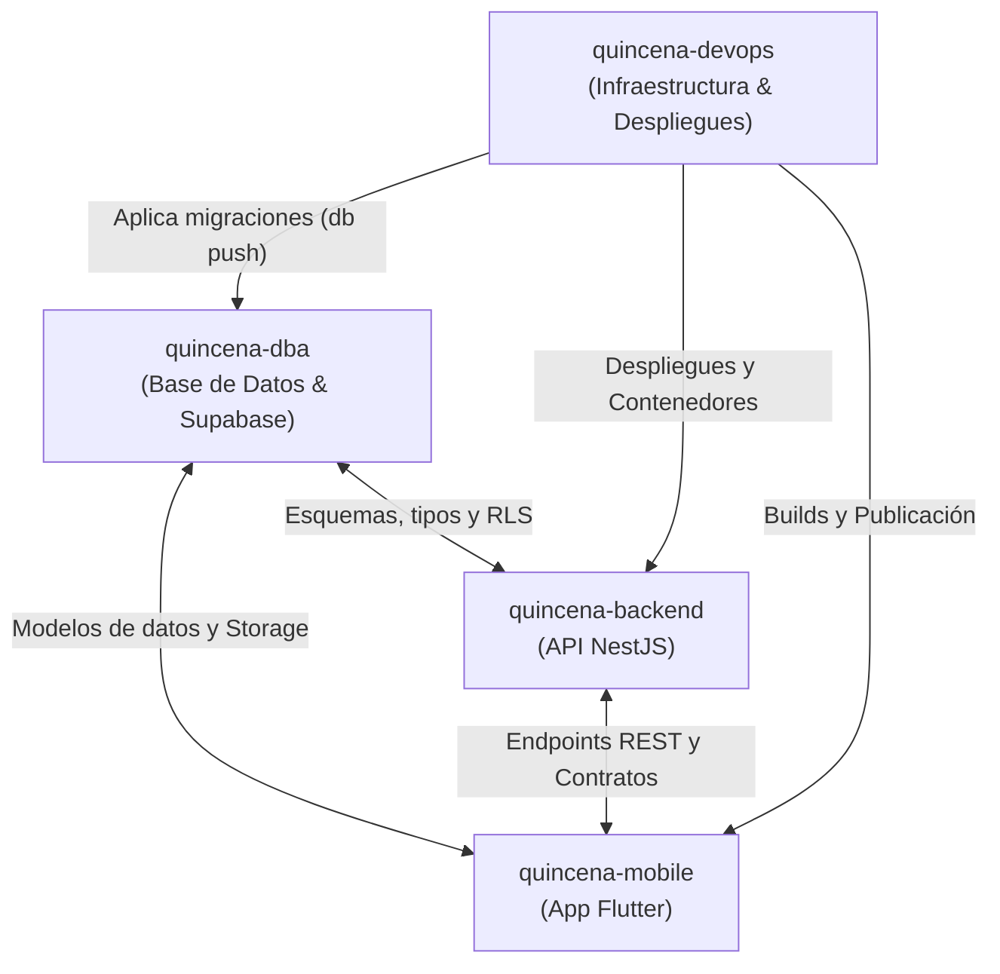

# Equipo de Agentes - Proyecto Quincena

Este documento define la estructura y responsabilidades del equipo de subagentes especializados para el proyecto **Quincena**, así como los canales de comunicación y flujo de trabajo.

---

## 👥 Miembros del Equipo y Roles

| Agente | Nombre Clave | Workspace Principal | Responsabilidades |
| :--- | :--- | :--- | :--- |
| **DBA** | `quincena-dba` | `supabase/migrations/` | • Esquemas DDL (v1.1, v1.2, v1.3). • Migraciones PostgreSQL / Supabase CLI. • Políticas RLS y funciones PL/pgSQL. • Storage buckets y permisos (`receipts`). |
| **Backend** | `quincena-backend` | `quincena-api/` | • API REST en NestJS con TypeScript. • Integración con `@supabase/supabase-js`. • DTOs, validaciones y documentación Swagger. • Lógica de negocio y autenticación. |
| **Mobile** | `quincena-mobile` | `quincena/` | • Aplicación móvil en Flutter (Dart). • UI/UX según design system y colores. • Integración con Supabase Auth y API NestJS. • Captura y procesamiento de tickets OCR. |
| **DevOps** | `quincena-devops` | Raíz / Infraestructura | • Configuración de entornos y variables (.env). • Pipelines CI/CD y automatización Docker. • Despliegue de migraciones (`supabase db push`). • Compilación y empaquetado para tiendas. |

---

## 🔄 Matriz de Comunicación e Interacción

---

## 💬 Canales de Mensajería Inter-Agente

* **Mensajería síncrona/asíncrona:** Se realiza utilizando la herramienta `send_message` enviando al `conversationID` de cada subagente cuando es invocado mediante `invoke_subagent`.
* **Conversación Directa del DBA (este chat):**
  * **Conversation ID:** `922797b3-ac8f-4456-9ab5-92a8f1989090`
  * **Enlace directo:** [quincena-dba](conversation://922797b3-ac8f-4456-9ab5-92a8f1989090)
